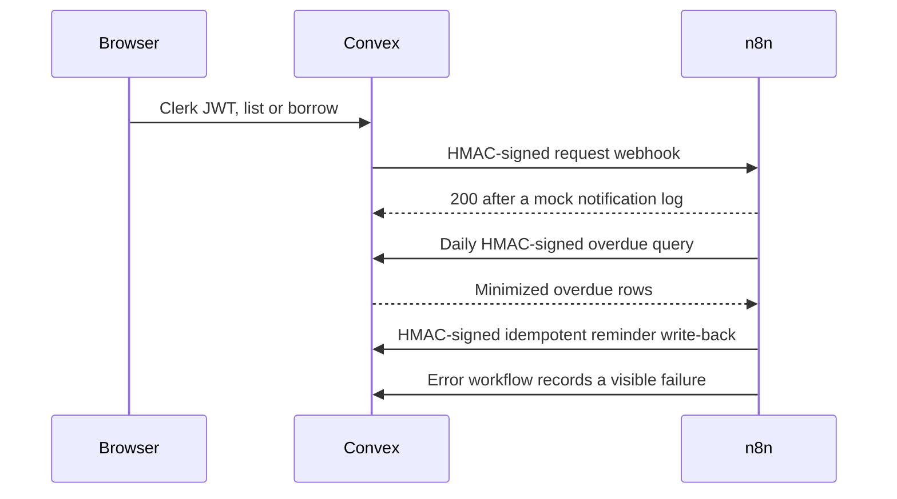

# LendLoop

Neighborhood tool-lending board. Neighbors list tools they will lend, request a date range, and get notifications from n8n.

Borrow what you need. Lend what you don’t.

## Stack

- Next.js App Router and TypeScript
- Clerk for authentication
- Convex for data and authorization
- n8n in Docker for request notifications, a daily overdue job, and an error workflow

## Architecture



Signed-in actions are enforced in Convex functions. The UI hides controls, but that is not the authorization boundary.

Public visitors only receive tool name and category. Owner name, email, description, and condition are not on that query. Webhook payloads use an allowlist: event, loan id, status, tool name, category, dates, recipient role, and recipient email. Reminder write-backs store the fixed summary `Reminder sent`. The server recomputes the idempotency key `overdue:{loanId}:{asOf}` and ignores a mismatched key, so retries do not create a second reminder.

Dates are UTC calendar dates (`YYYY-MM-DD`).

## Local setup

### 1. Install

```bash
npm install
cp .env.example .env.local
```

Fill `.env.local` with values from your own Clerk, Convex, and n8n projects. Do not commit that file. `.env.example` has empty placeholders only.

Until `NEXT_PUBLIC_CLERK_PUBLISHABLE_KEY`, `CLERK_SECRET_KEY`, and `NEXT_PUBLIC_CONVEX_URL` are all set, the app renders a setup screen instead of calling Clerk or Convex.

### 2. Clerk

1. Create a Clerk application.
2. Put the publishable key and secret key in `.env.local`.
3. Create a JWT template named `convex`:
   - Audience: `convex`
   - Claims:

```json
{
  "aud": "convex",
  "email": "{{user.primary_email_address}}",
  "name": "{{user.full_name}}"
}
```

4. Copy the issuer (the Frontend API URL, such as `https://your-app.clerk.accounts.dev`) into `CLERK_JWT_ISSUER_DOMAIN`.

Sign-in and sign-up routes are `/sign-in` and `/sign-up`. The public page button says “Sign in to lend or borrow”.

### 3. Convex

```bash
npx convex dev
```

In another terminal, set Convex environment variables (same webhook secret you will give n8n):

```bash
npx convex env set CLERK_JWT_ISSUER_DOMAIN https://your-app.clerk.accounts.dev
npx convex env set LENDLOOP_WEBHOOK_SECRET "$(openssl rand -hex 32)"
npx convex env set N8N_REQUEST_WEBHOOK_URL http://host.docker.internal:5678/webhook/lendloop-request
npx convex env set ADMIN_EMAILS you@example.com
```

Copy the deployment URL (`https://….convex.cloud`) into `NEXT_PUBLIC_CONVEX_URL`.

Copy the site URL (`https://….convex.site`) into `CONVEX_SITE_URL` for n8n.

The first signed-in user whose email is listed in `ADMIN_EMAILS` becomes an admin. Admins can remove any listing, view every loan, and mark a user as a trusted lender. Everyone else can create, edit, and delete only their own listings, and can act only on requests where they are the lender or the borrower. Admins do not get to approve someone else’s request.

### 4. n8n

Generate a long `N8N_ENCRYPTION_KEY` yourself and put it in `.env.local`, next to the same `LENDLOOP_WEBHOOK_SECRET` and `CONVEX_SITE_URL`.

```bash
docker compose up
```

Open `http://localhost:5678`, create the local owner account, then import, in order:

1. `n8n/workflows/error-workflow.json`
2. `n8n/workflows/request-notification.json`
3. `n8n/workflows/overdue-reminders.json`

On the request and overdue workflows, open Settings and set **Error Workflow** to `LendLoop — error workflow`. n8n assigns that id on import, so it is not hardcoded in the JSON.

Activate all three workflows. The request webhook path is `lendloop-request`. While n8n is in test mode the URL uses `/webhook-test/` instead of `/webhook/`.

`N8N_BLOCK_ENV_ACCESS_IN_NODE=false` lets the code nodes read `LENDLOOP_WEBHOOK_SECRET` and `CONVEX_SITE_URL` from the environment. The secret is not written into the exported JSON. Outbound HTTP nodes retry three times. A failed run is picked up by the error workflow, which signs a minimized failure record and posts it to Convex, where admins can see it.

Notifications are a log line in the n8n execution (a mock notification). Swap that code node for email, Slack, or Discord without changing the payload.

If the webhook URL or secret is missing, Convex still records a visible automation event on the loan instead of failing silently. Convex also retries the webhook three times before recording a failure and raising, so the scheduler can retry the action.

### 5. Run the app

```bash
npm run dev
```

Open `http://localhost:3000`.

| View | Who |
| --- | --- |
| `/` | Public available tools, name and category only |
| `/board` | All tools, availability, category filter, borrow requests |
| `/board/listings` | Create, edit, and remove your listings |
| `/board/requests` | Your borrow requests, cancel, mark returned |
| `/board/incoming` | Approve, decline, or mark returned on your tools |
| `/board/admin` | All loans, trusted lenders, remove any listing, failures |

Each loan has an Activity control. A reminder reads like “Reminder sent 2 days ago”.

## Scripts

```bash
npm test
npm run lint
npm run typecheck
npm run build
npm run workflows   # regenerate n8n/workflows/*.json from n8n/build.mjs
```

## Roles

| Action | User | Admin |
| --- | --- | --- |
| Create, edit, delete own listing | yes | only if they own it |
| Remove any listing | no | yes |
| Request, cancel own request, mark a loan they are part of returned | yes | only when they are borrower or lender |
| Approve or decline | lender only | lender only |
| View all loans, mark trusted lender | no | yes |

Trusted lender is a badge on the signed-in board. It is not shown on the public page.

## What I would change for production

- Run n8n on a private network, pin the image digest, and alert a person from the error workflow (email or Slack) in addition to the Convex log.
- Put the webhook behind HTTPS only, rotate `LENDLOOP_WEBHOOK_SECRET`, and keep a previous secret during rotation.
- Use a real mail provider. Keep the allowlist so templates cannot receive descriptions or Clerk ids.
- Move admin assignment to a Clerk organization role checked again in Convex, and write an audit row for removes and trusted-lender changes.
- Replace full-table scans with indexed availability once the catalog is large. Add rate limits on Convex HTTP actions.
- Store dates with an explicit neighborhood timezone instead of UTC calendar dates.
- Ship Clerk and Convex production instances, separate n8n credentials per environment, and keep webhook URLs out of client bundles. `NEXT_PUBLIC_*` values are inlined at build time, so production builds must be produced with those public values set.
